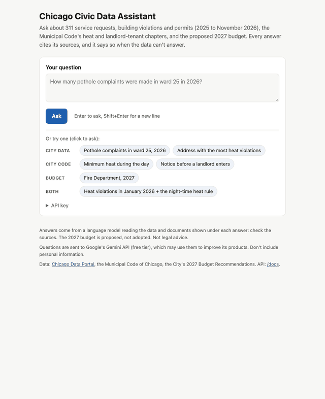

# Chicago Civic Data Assistant

Ask questions about Chicago in plain English and get answers that **cite their sources**. The service answers from the city's open data (311 service requests, building violations, building permits) with **Text-to-SQL**, from city documents (the Municipal Code's heat and landlord-tenant chapters, the proposed 2027 budget) with **retrieval (RAG)**, or both in one answer. When the data can't answer, it says so.



> "How many rat complaints were made in ward 1 in 2026, and what must a landlord do about rodents?"
> → 1,099 complaints, from a SQL query over 1.8 million 311 requests [1], and the landlord's duty from Municipal Code section 5-12-110 [2], with the sentence that says so highlighted. 5.7 s (paid tier, nothing cached).

## The problem

Chicago publishes millions of records and thousands of pages of code and budget, but answering "how many heat violations were there last winter, and what heat must my landlord provide?" means a SQL query on one site and a legal text on another. A plain chatbot answers confidently and often wrongly. This project answers from the real data and documents, shows exactly which query or section each claim came from, and refuses when the sources don't support an answer.

## Results

Measured on 87 hand-built questions with answers computed from the data (`evals/`), and on 15 **held-out** questions written before the final fixes and scored once:

| Metric | First run | Final | Held-out (15) |
| --- | --- | --- | --- |
| Answer correctness (deterministic checks) | 84.4% | **100%** | **100%** |
| SQL execution accuracy | 79.1% | 97.7%* | 100% |
| Retrieval recall@5 | 97.7% | 100% | 100% |
| Faithfulness (LLM judge, hand-checked) | 100% | 100% | 100% |
| Citation accuracy | 98.7% | 100% | 100% |
| Correct refusals (unanswerable questions) | 10/10 | 10/10 | 2/2 |
| Latency p50 / p95 (paid Gemini tier) | | 2.3 s / 4.1 s | 2.7 s / 4.5 s |
| Cost per question | | $0.003 | $0.003 |

\* The one miss is a scorer false alarm (a month returned as a date instead of a name; the answer is right). The 87 questions were also used to find failures, so the held-out set is the fairer number, though small. Full tables, the experiments and the judge's hand check are [below](#evaluation).

## How it works

```
                      ┌────────────── Router (LLM): data, documents, or both? ──────────────┐
question ─► /query ──►│                                                                       │
                      ▼                                                                       ▼
            SQL agent (LLM writes SQL)                                     Search the documents
            │ guard: one SELECT, 3 tables, row limit (sqlglot)             │ vector search (pgvector)
            │ review in code: duplicates, city-generated, ties, ...        │ + exact section lookup
            │ read-only role, read-only transaction, 15 s timeout          │ top 5 chunks
            ▼                                                              ▼
            Postgres: 311, violations, permits ──────►  LLM writes the answer  ◄────── code sections, budget pages
                                                        │ cites [T1] / [D1..D5]
                                                        ▼
                                code builds the citations; an uncited answer is refused
```

What makes the answers trustworthy:

- **The model never touches the database directly.** Its SQL is parsed (one `SELECT`, only the three tables, only allow-listed functions, a row limit), then run as a role that is read-only by itself, inside a read-only transaction with a timeout.
- **Rules a regular expression can check are checked in code, not just asked for in the prompt** (`app/sql_review.py`): 311 duplicates excluded, city-generated requests kept, average vs. median, ties hidden by `LIMIT 1`. A problem goes back to the model once to fix.
- **Data traps are documented and tested**: `ILIKE '%tree%'` also matches "Street", the heat rule moved from section 13-196-410 to 14X-8-802.2.2 but the violations data still cites the old number, the budget is proposed, not adopted ([docs/TABLES.md](docs/TABLES.md), [docs/SOURCES.md](docs/SOURCES.md)).
- **Citations are built by code from the sources actually given to the model**; an answer with no valid citation is turned into a refusal.

## Try it

- **Web page:** https://civic-api-408605137306.us-east5.run.app (needs an API key: ask the owner). The demo runs on Gemini's free tier, so answers can take 15–30 s when it's busy.
- **API:** `POST /query` with `{"question": "..."}` and an `X-API-Key` header; reference at [`/docs`](https://civic-api-408605137306.us-east5.run.app/docs).

The response has the `answer` (with `[1]`, `[2]` markers), the `route` (sql, docs or both), the `citations` (the SQL that ran, or the code section / budget page with a link), `refused`, `latency_ms`, token `usage` and `cost_usd`. Errors: `401` bad key, `422` bad input, `429` too many questions (per client: 5 a minute, 50 a day; `Retry-After` says when to try again), `502` the language model failed, `503` database down or daily quota used up, `504` no answer within 30 s. Each response has an `X-Request-ID` header that matches its line in the server log.

## Run it locally

Prerequisites: Python 3.12+, Docker, a [Gemini API key](https://aistudio.google.com) and a [Chicago Data Portal app token](https://data.cityofchicago.org) (both free).

```bash
python3 -m venv .venv && source .venv/bin/activate
pip install -r requirements-dev.txt          # requirements.txt = only what the API image installs
cp .env.example .env                         # add your keys
docker compose up -d db                      # Postgres 16 + pgvector
python scripts/check_db.py                   # Postgres up, pgvector on, read-only role works
python -m ingest.load_tables --since 2025-01-01   # the three tables (~360 MB)
python -m ingest.load_docs                   # PDFs downloaded by hand to data/docs/ first (docs/SOURCES.md)
uvicorn app.main:app --reload                # http://localhost:8000 (page) and /docs
```

With Docker, as deployed: `docker compose up --build api`. Tests: `pytest -q` (194; no database or API key needed: the models and database are faked). Evals: `python -m evals.run_evals --label mine` (~$0.30 on a paid key; replies are cached, so re-runs are free).

## Deployment

| Piece | Where |
| --- | --- |
| API + page | Cloud Run, `us-east5` (Ohio), one instance, scales to zero (`scripts/deploy.sh`); image 438 MB, non-root |
| Database | Neon free plan, `aws-us-east-2` (Ohio), copied from the local one by `scripts/setup_neon.py`; the API connects as the read-only `civic_reader` |
| Secrets | Google Secret Manager (Gemini key, the service's API key, the read-only database URL), read at startup, never in the image |
| Gemini | The public demo uses a free-tier key from a project with billing off, so visitors can't create costs; development and CI use a paid key |
| Limits and logs | Per client 5 questions a minute and 50 a day, 100 a day in total; one JSON log line per question (status, latency, tokens, cost) |
| CI | GitHub Actions: 194 tests on every push; on pull requests, a live 10-question eval against Neon that fails below 80% (~$0.04 a run) |

## Evaluation

87 eval questions (`evals/questions.jsonl`: 33 table, 34 document, 10 both, 10 unanswerable), with reference answers computed from the data and the documents (`evals/build_questions.py`), plus the 15 held-out questions. Answer model `gemini-3.1-flash-lite`, judge `gemini-3.5-flash-lite` (a different model, so it doesn't grade itself).

| Metric | Baseline (Day 9) | After Day 11 fixes | Held-out (15, scored once) | Target |
| --- | --- | --- | --- | --- |
| Router accuracy | 100% (87/87) | 100% | 100% (15/15) | 90%+ |
| SQL execution accuracy | 79.1% (34/43) | 97.7% (42/43) | 100% (9/9) | 85%+ |
| Recall@5 / MRR | 97.7% / 0.76 | 100% / 0.86 | 100% / 0.71 | 80%+ / 0.6+ |
| Answer correctness (checks) | 84.4% (65/77) | 100% (77/77) | 100% (13/13) | 80%+ |
| Answer correctness (LLM judge) | 89.6% | 98.7% | 100% | |
| Faithfulness (LLM judge) | 100% (77/77) | 100% | 100% | 90%+ |
| Citation accuracy | 98.7% | 100% | 100% | 90%+ |
| Correct refusals / false refusals | 100% (10/10) / 0% | 100% / 0% | 100% (2/2) / 0% | 90%+ |
| Latency p50 / p95, every call live | 16.7 s / 70.2 s (free tier, overloaded) | 2.3 s / 4.1 s (paid tier) | 2.7 s / 4.5 s | p95 under ~8 s |
| Cost per question | $0 (free tier) | $0.0029 (~10,400 tokens) | $0.0030 | reported |

The judge agreed with a hand check on 18 of 20 correctness verdicts and 20 of 20 faithfulness verdicts, and caught 3 of 3 planted false claims. It is lenient on near-miss numbers, so the headline correctness figure comes from deterministic checks.

**Experiments** (Day 10, one change at a time on the same questions):

| Change | SQL execution | Recall@5 | Answer checks | Decision |
| --- | --- | --- | --- | --- |
| Baseline (hybrid search, `gemini-3.1-flash-lite`) | 79.1% | 97.7% | 84.4% | |
| Vector search instead of hybrid (BM25 + vector, RRF) | 79.1% | **100%** | **87.0%** | **adopted** |
| Cross-encoder reranker on (retrieval only) | | 72.7%† | | rejected |
| Fixed 500-token chunks instead of one per section | | 95.5%† | | rejected (no gain) |
| Answer model `gemini-3.5-flash-lite` | **93.0%** | 97.7% | **90.9%** | not adopted: equal after the Day 11 fixes |

† key-phrase relevance; hybrid scores 95.5% on the same measure.

## Security

Checked by testing, not assumed (details: the "Security pass" entries in [docs/BUILD_LOG.md](docs/BUILD_LOG.md)):

| Layer | Defense |
| --- | --- |
| LLM-written SQL | Parsed with sqlglot: one `SELECT`, three tables, **allow-listed functions** (32 hostile queries refused; 262 known-good ones pass), row limit |
| Database | Role `civic_reader`: SELECT on four tables only, read-only by default, no temp tables, 20 connections, 15 s timeout; plus a READ ONLY transaction per query |
| API | 256-bit API key compared in constant time; key guessing limited; per-client and service-wide rate limits that a forged `X-Forwarded-For` can't dodge; 16 KB body limit; HSTS, nosniff, no framing, no caching on every response |
| Page | Server text inserted as text only (no `innerHTML`); strict Content Security Policy; only `http(s)` links |
| Secrets | In Secret Manager; never in git (history scanned), the image or logs; logs hold a salted client hash, not IPs or questions |
| Cloud | Each service account holds only the permissions it needs; Gemini keys restricted to the Gemini API; the demo key has no billing |
| Supply chain | Pinned dependencies (pip-audit clean), actions pinned to commit ids, Dependabot, secret scanning with push protection |

## Limits

- **Coverage:** three tables from 2025-01-01 to mid-November 2026, four document sets. 311 information-only calls and aircraft-noise complaints aren't loaded; building violations have no ward column. Such questions are refused.
- **The free-tier demo is slow at times** (p50 17 s, p95 35 s measured), against 2–4 s on the paid tier.
- **15 held-out questions is a small test,** written by the same person who wrote the fixes.
- **Not legal advice.** Answers can be wrong; the citations are there to check them.

## Repository

`app/` (API, page, router, SQL agent and guardrails, search, answer), `ingest/` (table and document loaders), `evals/` (questions, runner, judge review, experiments), `scripts/` (database checks, Neon setup, deploy), `tests/`, `docs/`. Every step, decision and measurement, with the reasons and the dead ends: [docs/BUILD_LOG.md](docs/BUILD_LOG.md).

## Data sources

- [Chicago Data Portal](https://data.cityofchicago.org): 311 Service Requests, Building Violations, Building Permits
- [Municipal Code of Chicago](https://codelibrary.amlegal.com/codes/chicago/latest/chicago_il) chapters 14X-8, 5-12, 5-16 (American Legal Publishing; informational copy)
- City of Chicago 2027 Budget Recommendations (proposed)

Details, dataset ids and known data traps: [docs/SOURCES.md](docs/SOURCES.md).
